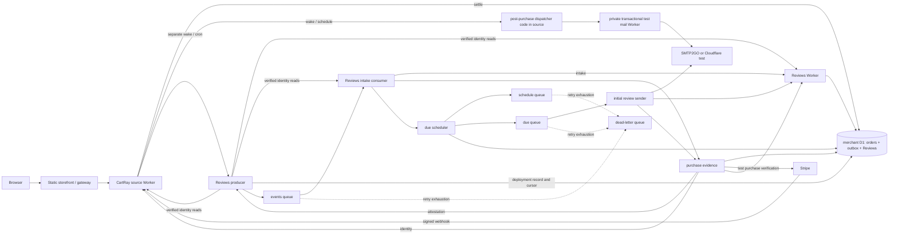

# CartRay product and architecture audit

Status: **review draft, no implementation or deployment authorization**. Baseline: `7e33b0959fcfbe7cd04d7ac018854ae8a607322f` (merged main). Evaluated proposals: [#89](https://github.com/mitchins/cart-ray/pull/89) `82789366408e`, [#90](https://github.com/mitchins/cart-ray/pull/90) `164ea67664f2`, [#92](https://github.com/mitchins/cart-ray/pull/92) `047f776ec445`. These are different branches, not a combined installation. This is a source audit, with an independent examination of each domain. It does not assert the current contents or configuration of a hosted account. No cloud mutation, message, payment, data reset or implementation change was made. Test qualification and historical receipts are evidence of their stated runs, not proof of present deployment.

The [schema inventory](product-cruft-data-inventory.md) accounts for all 75 `CREATE TABLE` definitions in the four installed migration chains, plus the operator-created ledger. One physical D1 contains logically separate data; shared D1 access does **not** provide table-level isolation. Historical migrations and records must not be deleted to implement this audit. An exhaustive live-resource census, installed routes, actual row counts and the uncertain EP claim were not inspected; absence from the installer graph is not proof of absence from a separately deployed service.

## Product contract and direct findings

A merchant configures a store, payment, fulfilment and **one transactional delivery provider**. A confirmed order should produce **one itemised merchant order confirmation** with the purchased resources. Reviews are configurable: include eligible review links **with the receipt**, send a **follow-up**, or select both where the merchant deliberately wants both. If neither is selected, there is no review invitation. For an order with multiple reviewable products, select **all eligible products** or **one first/prioritised eligible product**, using a deterministic merchant-configured rule over canonical eligible subjects, deduplicated across quantities and mappings; persist the selection used for retries. Do not silently choose a product or create one email per product. The owner still needs to specify whether one-product selection limits eligibility or only the products featured in a message; if it limits eligibility, enforce the restriction server-side. Both message modes share per-subject review progress. Follow-up timing is a narrow optional setting. Re-evaluate each product against the current submitted-review state when a follow-up becomes due, so a previously submitted product is not solicited again; receipt and follow-up share per-subject progress. Preserve the agreed non-expiring default and all existing issued invitations; expiry is allowed only when explicitly configured. The product's existing checkout permission and suppression rules must be enforced for the selected review message; an optional review being ineligible, suppressed, unavailable or unpermitted must never suppress the transactional receipt. The permission basis for a particular merchant/message must be configured and qualified, not inferred from the mere fact of purchase. The receipt must represent every purchased line and each applicable resource or its honest unavailable/pending state; failure of one resource must not invalidate others. Provide an operator-visible recovery path without automatically sending a second receipt.

The current baseline does **not** implement that composed default. The test-only transactional handler sends dummy links per configured workflow, not a complete itemised receipt with review links ([handler](../../modules/post-purchase/transactional-email/worker.mjs#L15); [dispatcher](../../src/cartray/post_purchase.py#L273)). Multiple matching workflows intentionally produce multiple provider calls: [the test asserts two sends for one order](../../tests/post_purchase_email.test.mjs#L153), and [the EP UAT guide](../../examples/ep-uat/README.md) describes one message per workflow. This is not evidence of a replay duplicate; it is the wrong *default confirmation granularity*. Reviews initial delivery is an additional, independently configured email path ([sender](../../modules/reviews/initial-dispatch/worker.mjs#L26)). Stripe's own receipt is not assumed to contain CartRay links.

An initial review link is prepared before sending but activated by the recorded acceptance outcome ([sender](../../modules/reviews/initial-dispatch/worker.mjs#L33); [generation transaction](../../modules/reviews/src/cartray_reviews/invitations.py#L650)). If a provider accepts but the acknowledgement is lost, a customer can receive a link that has not been activated. Acceptance is useful evidence, not a sound prerequisite for a first order's review entitlement. Replacement is different: retaining the previously valid, not-explicitly-revoked link after an uncertain replacement is necessary; expired, withdrawn or revoked capabilities must not be resurrected; a new design must preserve that guarantee and old capability verification.

## Architecture inventory

Status labels describe source/declared graph, not proof of current hosted configuration. The operator generates a **test-only** topology: source plus six Reviews roles and four queues on one D1; a configured post-purchase action adds an eighth operator-managed Worker role. These counts exclude a conditional Pages advanced-mode `_worker.js` gateway or an external storefront routing layer; they are execution resources too. The [INFRA-01 receipt](../../modules/reviews/operator/qualification/infra-01-2026-11-10.json) records a previously qualified seven-Worker/four-queue test installation, paused at that time. It is not a current EP inspection. [Topology source](../../modules/reviews/operator/topology.py#L93), [role selection](../../modules/reviews/operator/operate.py#L426).

| Component / actual entrypoint | Requirement and callers | Configuration, state, dependencies | Status; default disposition |
|---|---|---|---|
| Storefront/GEL, static catalogue and gateway: [`storefront/`](../../storefront), [`examples/gel-theme-pack/`](../../examples/gel-theme-pack), [`reviews_gateway.mjs`](../../examples/acorn-store/reviews_gateway.mjs), [`connected_flows.py`](../../examples/gel-theme-pack/connected_flows.py) | Browsing, cart, checkout and reviews presentation; browser calls same-origin gateway/commerce | Static assets, approved presentation/catalogue, API origin; the optional hosted Pages gateway is an additional execution resource; no authority from price or route shown to browser | **KEEP**. Connected merchants need presentation independent of Stripe authority. |
| Commerce Python Worker [`worker.py`](../../src/cartray/worker.py#L71), [`checkout.py`](../../src/cartray/checkout.py), [`settlement.py`](../../src/cartray/settlement.py) | Checkout, signed Stripe webhook, status and periodic reconciliation; webhook/scheduled wake downstream tasks | Stripe credentials/webhook secret, catalogue lock, commerce D1 and edge budgets | **KEEP** payment authority and scheduled reconciliation. Notification failure must not change settlement or block checkout. |
| Order store and outbox [`store.py`](../../src/cartray/store.py#L857) | Immutable purchase/items, idempotent settlement and `OrderConfirmed`; feeds both consumers | `orders`, `order_items`, `stripe_events`, `outbox`, checkout/session and reconciliation records | **KEEP**; never repurpose global delivery acknowledgement as another subscriber's cursor. |
| Post-purchase dispatcher [`post_purchase.py`](../../src/cartray/post_purchase.py#L235) | Source wake or scheduled drain reads confirmed events; per `(merchant, environment, order, workflow)` execution and immutable configuration digest | `post_purchase_installation`, `post_purchase_checkpoint`, `post_purchase_executions`, recovery audit; service binding and activation fence | **CONSOLIDATE** orchestration for the normal order confirmation, not the historical execution identities. Current matching workflows can independently call delivery. |
| Transactional email Worker [`transactional-email/worker.mjs`](../../modules/post-purchase/transactional-email/worker.mjs#L15) | Private handler called by dispatcher; test recipient and dummy links | SMTP2GO or Cloudflare test adapter, test sender/recipient, provider secret, Stripe API and config; acceptance/uncertainty | **CONSOLIDATE** transport with other senders; retain delivery identity, safe claim and provider receipt semantics. Current body is not the product receipt. |
| Reviews Worker [`src/worker.py`](../../modules/reviews/src/worker.py) and [`native_lifecycle.py`](../../modules/reviews/src/native_lifecycle.py) | Subject lookup, review submission, customer management, moderation, replies, audit and public reads | Reviews tables, optional staff auth and rate budgets; service boundary | **KEEP** capability validation, staff permissions, immutable revisions, moderation and publication; do not make Reviews responsible for generic mail. |
| Published review projection [`publication/worker.mjs`](../../modules/reviews/publication/worker.mjs), [`unified.py`](../../modules/reviews/src/cartray_reviews/unified.py) | Public approved native/historical content, withdrawal/version handling | Source/projection, version and tombstone state, optional cache | **KEEP** publication correctness; separate Worker deployment outside current installer graph is **unverified**, not dead. |
| Reviews source producer [`automation-intake-producer/worker.mjs`](../../modules/reviews/automation-intake-producer/worker.mjs#L61) | Source wake/cron reads outbox and delivers authenticated event | Verified installation record, source identity services, `reviews_subscriber_checkpoint`, events queue | **SIMPLIFY / CONSOLIDATE** the traversal for default receipt. Preserve replay handling and existing watermark; runtime control-plane calls were already removed. |
| Intake consumer [`automation-intake-queue/worker.mjs`](../../modules/reviews/automation-intake-queue/worker.mjs#L32) | Events queue delivers scoped acquisition to Reviews, asks evidence and scheduler | events/DLQ, service auth, intake/recipient evidence and due scheduling | **CONSOLIDATE** overlapping orchestration; keep purchase eligibility and idempotency. A single shared flow still needs durable per-purpose state. |
| Purchase evidence [`consent/purchase_evidence.mjs`](../../modules/reviews/consent/purchase_evidence.mjs#L31) | Consumer and sender ask for confirmed purchase, trusted recipient, consent and suppression | D1, Stripe test credentials, source/producer/Reviews identity services, pseudonym key | **KEEP the trust outcome; SIMPLIFY adapter**. This baseline hard-requires `STORE_KEY==='acorn-store'`; it is not a generic merchant production adapter. It repeats Stripe lookups also made by transactional handler. Use a trusted confirmed snapshot only after recipient provenance is proven. |
| Due scheduler [`automation-due-producer/worker.mjs`](../../modules/reviews/automation-due-producer/worker.mjs) | Schedules delayed invitation and due hints | schedule and due queues; `review_automation_due_schedule` and claims | **DEFER as optional follow-up**, not default receipt prerequisite. Preserve queued hints/claims during any transition; no polling service added. |
| Initial Reviews sender and unsubscribe [`initial-dispatch/worker.mjs`](../../modules/reviews/initial-dispatch/worker.mjs#L26) | Due queue sends one review-specific invitation; public POST unsubscribe | SMTP2GO test key, sender, approved recipient, delivery claim, generation/consent/suppression; no blind resend | **CONSOLIDATE mail delivery** into shared provider; **KEEP** purpose-specific unsubscribe, consent, signed capability and uncertain-send outcomes. Follow-up remains merchant-configurable. |
| Customer recovery [`dispatch/worker.mjs`](../../modules/reviews/dispatch/worker.mjs), [`smtp2go-recovery/worker.mjs`](../../modules/reviews/smtp2go-recovery/worker.mjs) | Recovery queue creates replacement and sends it through a separate test adapter | recovery queue/claim and MAIL/SMTP2GO service; generation CAS and uncertain states | **CONSOLIDATE transport**, preserve management and recovery behavior and previous valid link until safe replacement. Separately deployed status unverified. |
| Provider evidence [`provider-reconciliation/worker.mjs`](../../modules/reviews/provider-reconciliation/worker.mjs) | Authenticated staff/provider activity lookup and recipient-scoped discovery, no resend | separate activity-read credential, historical recipient service, provider IDs and immutable observations | **SIMPLIFY / CONSOLIDATE** operator evidence with common delivery ledger; **KEEP** unknown vs accepted vs delivered and no blind resend. Not in the standard graph; actual deployment unverified. |
| Legacy post-checkout verification [`consent/worker.mjs`](../../modules/reviews/consent/worker.mjs), [`authority.mjs`](../../modules/reviews/consent/authority.mjs), [`test_email_transport.mjs`](../../modules/reviews/consent/test_email_transport.mjs) | Test purchaser context, one-time code and opt-in sender; not the selected checkout-permission UX | context D1, email transport/recipient secrets, challenge, grants and verification tables | **REMOVE CANDIDATE** for the normal journey; it is absent from the current operator graph. Check independently deployed routes and consumers first; retain historical records and do not delete the active purchase-evidence adapter. No assertion of dead code. |
| Alternative synthetic queue [`automation-queue/worker.mjs`](../../modules/reviews/automation-queue/worker.mjs) | Earlier synthetic automation evaluator | test-only mode, queue bindings | **REMOVE CANDIDATE**, deployment/use unverified; prove no active callers and preserve fixtures/records before removing. |
| Reviews gateway and console [`gateway/worker.mjs`](../../modules/reviews/gateway/worker.mjs), [`console/`](../../modules/reviews/console) | Public and staff surfaces / integration adapters | source routing, authenticated identity and narrowly scoped permissions | **KEEP** merchant/customer function; **SIMPLIFY** deployment and use a real staff boundary, not public test-admin credentials. Actual external bindings vary. |
| Migration/import tooling [`migration/wordpress/`](../../modules/reviews/migration/wordpress), [`tools/`](../../modules/reviews/tools) | Historical import, reconciliation, local Workerd builds and qualification | approved snapshots, explicit source mappings and independent data | **DEFER** from greenfield default; preserve interfaces, imported IDs/provenance and existing tests. No current migration work or deletions. |
| Merchant operator and deployment verifier [`operate.py`](../../modules/reviews/operator/operate.py), [`post_purchase_operator.py`](../../modules/reviews/operator/post_purchase_operator.py), [`verify.mjs`](../../modules/reviews/operator/verify.mjs), [`cloud.py`](../../modules/reviews/operator/cloud.py) | Installation, build, D1 migrations, deploy, private topology, activation, health, upgrades and rollback | private inventory/vault, operator control-plane token, secrets, release/version metadata, activation and no-backfill records | **SIMPLIFY** one merchant workflow and shared mail configuration; **KEEP** protected secret handling, migration checksums, verification at deployment, deliberate activation and compatible rollback. No new attestation service. |
| Scripts and examples [`scripts/`](../../scripts), [`examples/`](../../examples) | Locked catalogue/Worker builds, preflight, synthetic UAT, optional post-purchase installation/recovery | local inputs/locks, private handoff, Workerd/sandbox fixtures | **KEEP** reproducible supported commands; **DEFER / REMOVE CANDIDATE** obsolete stand-alone experiments only after caller/deployment evidence. CI and fixture presence alone is not product justification. |
| Channel continuity #89 [`src/cartray/channels/`](https://github.com/mitchins/cart-ray/tree/82789366408e/src/cartray/channels) | Offline export, compare and operator transition evidence | explicit external identities and snapshots; no runtime Worker or automatic publish | **DEFER / REVISE**; preserve IDs, URLs and accurate feed data when a merchant needs a channel cutover. |
| Proposed fulfilment #90 [`fulfilment.py`](https://github.com/mitchins/cart-ray/blob/164ea67664f2/src/cartray/fulfilment.py) | Purchased resource identities, private/external access, mixed providers | proposed entitlement/capability tables, private storage bindings and notification intents | **REVISE / SPLIT**: keep durable purchase access; separate grants from notification composition and per-workflow mail. |
| Proposed Reviews Cloudflare sender #92 [`diff`](https://github.com/mitchins/cart-ray/pull/92/files) | Adds Cloudflare to separate initial Reviews sender | another provider configuration, credential, receipt table and operator transition | **CLOSE, do not merge as designed**; preserve branch and evidence for reuse in common delivery. Do not touch retained hosted state. |

### Customer email call sites

The checked-in runtime and example source contains these direct delivery implementations. Each uses its own claim/configuration today; shared names do not imply shared state. This static inventory does not prove which stand-alone services are currently deployed.

| Direct sender | Actual use and disposition |
|---|---|
| [`modules/post-purchase/transactional-email/worker.mjs`](../../modules/post-purchase/transactional-email/worker.mjs) | Private test workflow handler; SMTP2GO or Cloudflare. Consolidate provider delivery into the receipt boundary. |
| [`modules/reviews/initial-dispatch/worker.mjs`](../../modules/reviews/initial-dispatch/worker.mjs) | Independent SMTP2GO test initial review request on the due queue. PR #92 adds another provider to this path; do not add another default sender. |
| [`modules/reviews/smtp2go-recovery/worker.mjs`](../../modules/reviews/smtp2go-recovery/worker.mjs), called by [`dispatch/worker.mjs`](../../modules/reviews/dispatch/worker.mjs) | Optional, separately bound recovery email. Consolidate the provider call but retain scoped recovery and uncertain-outcome behavior. |
| [`modules/reviews/consent/test_email_transport.mjs`](../../modules/reviews/consent/test_email_transport.mjs), called by [`authority.mjs`](../../modules/reviews/consent/authority.mjs) | Test email-verification code for the superseded post-checkout journey. Not in the standard installer graph; deployed use remains unverified. |
| [`examples/ep-uat/delivery_email.py`](../../examples/ep-uat/delivery_email.py) | Local EP UAT SMTP2GO experiment with its own `uat_delivery_emails` SQLite claim keyed by order. It is not the supported hosted handler; retain evidence and retire the example only after its remaining callers are checked. |
| [`modules/reviews/tools/test_mailbox.py`](../../modules/reviews/tools/test_mailbox.py) | Local Maildir sink for synthetic tests; it does not send external mail. Keep only as useful test tooling, not another merchant email provider. |

Provider-activity reconciliation queries SMTP2GO history but does not send an email. Stripe may independently send its own receipt according to account settings; no claim is made that this external configuration can include CartRay capabilities.

### Current topology and event paths

`events`, `schedule`, `due` and dead-letter queue are declared in the installer; the graph is conditional and test-only. Source hourly reconciliation repairs payment confirmation; the activated Reviews producer has a minutely trigger ([source Worker](../../src/cartray/worker.py#L489), [operator scheduling](../../modules/reviews/operator/operate.py#L1148)). The source maintains a post-purchase checkpoint and separately wakes a Reviews subscriber with its own fence/cursor; neither cursor is the other consumer's acknowledgement ([post-purchase drain](../../src/cartray/post_purchase.py#L383), [Reviews relay](../../modules/reviews/automation-intake-producer/worker.mjs#L61)). Confirmed replay must not duplicate a delivery; a distinct configured workflow is currently a distinct legitimate execution. One shared order-level email claim must not erase existing workflow identities, their historical decisions or unknown claims.

## Merchant/operator operations inventory

The baseline parser exposes **17 named commands** ([entrypoint](../../modules/reviews/operator/operate.py#L2001)). This is an operator/developer tool, not evidence that an ordinary merchant can manage the product unaided.

| Commands | Purpose | Decision |
|---|---|---|
| `plan`, `provision`, `migrate`, `build`, `deploy` | account/resource plan, one D1 and Workers, checksummed migrations, locked build, staged deployment | KEEP developer deployment capability; consolidate into a documented resumable install/upgrade path. No manual SQL. |
| `verify`, `doctor`, `receipt` | compare deployment/resources, explain drift and record test evidence | KEEP simple actionable diagnostics; consolidate duplicate attestations and merchant-facing evidence paperwork. A temporary management API outage must not break ordinary runtime. |
| `activate`, `pause` | independent Reviews automation fence and queue operation | SIMPLIFY to deliberate merchant feature enablement and one operator deployment action; keep no-backfill fence and an emergency way to stop follow-ups without stopping receipts or unsubscribe. |
| `post-purchase-activate`, `post-purchase-disable` | independently stage and toggle handler and source mail worker | CONSOLIDATE with order-confirmation enablement and common delivery state; never reset checkpoint, implicitly resend, or turn off checkout. |
| `post-purchase-reconfigure-provider`, `attest-reviews-handoff` | separate provider/vault transition and Reviews SMTP handoff attestation | REMOVE from ordinary merchant path after shared mail provider exists; retain a narrowly scoped operator recovery/transition procedure for actual retained installations. Do not reset EP's uncertain claim. |
| `upgrade`, `rollback` | compatible Worker release change; no D1 rewind | KEEP safe compatibility checks, backups and explicit exceptional recovery; simplify deploy sequencing. A Worker rollback must not restore old database state. |
| `request` | private test service call and optional test admin | DEFER from merchant workflow; use a properly authenticated console for supported actions. |

The separate [`post_purchase_installation.py`](../../scripts/post_purchase_installation.py) establishes the explicitly authorised no-backfill fence, and [`post_purchase_recovery.py`](../../scripts/post_purchase_recovery.py) offers operator `inspect`/`hold` for claimed executions and provider evidence. These are additional to the 17 commands above. Preserve access to recovery for the retained EP uncertain claim until a supported replacement exists; do not run it during this audit.

An independent signing/binding check and a distinct private provider credential address concrete unauthorized delivery or secret disclosure; some per-Worker fingerprint/handoff transitions exist because provider mail is split into two independent stacks. Replace duplicated ceremony with one managed configuration and verified deployment, not anonymous trust or a new identity service. Suppression HMAC names include `acorn-recipient-v1/v2` ([evidence adapter](../../modules/reviews/consent/purchase_evidence.mjs#L126)); these bytes affect persisted suppression hashes. Ugly naming is not permission to rename or regenerate keys: compatibility is required.

### Fixture assumptions and leakage boundaries

The standard graph is explicitly test-only. [`topology.py`](../../modules/reviews/operator/topology.py#L39) restricts the EP UAT lane to an exact synthetic workflow, offer, approved recipient and dummy Dropbox Transfer, and the [transactional handler](../../modules/post-purchase/transactional-email/worker.mjs#L79) validates that provider-specific test URL. [`operate.py`](../../modules/reviews/operator/operate.py#L224) and [`post_purchase_operator.py`](../../modules/reviews/operator/post_purchase_operator.py#L127) also contain EP-test-lane controls. These are current safety restrictions, not production-authorised fulfilment or generic merchant configuration. Move test policy to explicit fixture configuration only in an approved implementation; do not loosen the live test boundary now. Acorn example catalogue, branding and fixtures are intentional examples; the hardcoded `acorn-store` in the active purchase-evidence adapter is the concrete generic-runtime limitation. Preserve HMAC inputs and existing suppression identities.

## Cruft register and sequencing

Each proposal below is a decision for review, not permission to delete. Scope estimates are relative; a phase can be split further. All impacts include retaining existing data, audit and issued capabilities.

| Classification and source | Evidence and proposed action | Merchant/customer effect | Scope |
|---|---|---|---|
| **KEEP** signed settlement and confirmed snapshot ([worker](../../src/cartray/worker.py#L213), [store](../../src/cartray/store.py#L857)) | Payment authority, durable items and idempotent outbox prevent false fulfilment | Checkout and correct purchased items remain available independently | Small integration; no settlement redesign |
| **CONSOLIDATE** per-workflow delivery + initial/recovery senders ([dispatcher](../../src/cartray/post_purchase.py#L273), [sender](../../modules/reviews/initial-dispatch/worker.mjs#L26)) | Multiple independent clients/credentials/states; unify provider delivery and one receipt composition per order | One default receipt; an explicitly enabled follow-up remains a separate purposeful email | Medium, separate order-message/recipient/claim tests |
| **KEEP** no-repeat / uncertain claim ([dispatcher](../../src/cartray/post_purchase.py#L330), [initial sender](../../modules/reviews/initial-dispatch/worker.mjs#L44)) | Lost acknowledgement cannot establish non-send; retain provider acceptance vs mailbox delivery and operator reconciliation | Avoid duplicate mail; manual evidence remains possible | Small shared delivery state, preserve old rows |
| **KEEP / SIMPLIFY** purchase eligibility, consent, suppression and unsubscribe ([evidence](../../modules/reviews/consent/purchase_evidence.mjs), [consent schema](../../modules/reviews/migrations/0006_review_invitation_consent.sql)) | Existing trust cannot come from browser email/session; review suppression applies to review content, not transactional receipt | Checkout remains unaffected; no unconsented optional follow-up | Medium; separately verify merchant policy and recipient provenance |
| **SIMPLIFY** capability availability ([invitation transaction](../../modules/reviews/src/cartray_reviews/invitations.py#L716)) | Provider acceptance currently triggers generation activation; decouple first receipt capability from mail ACK while retaining safe replacement logic | A received first email has a usable link; old links and uncertain replacements stay safe | Medium; token compatibility, replay and concurrency tests |
| **CONSOLIDATE** parallel order consumers ([source Worker](../../src/cartray/worker.py#L489), [Reviews relay](../../modules/reviews/automation-intake-producer/worker.mjs#L61)) | Two traversals, checkpoints and identity hops for the same D1 outbox; consolidate orchestration only where practical | Fewer moving parts; one subsystem outage cannot corrupt settlement | Medium; retain or drain historical cursors and fences, independent purpose dispositions |
| **DEFER** due scheduling ([due producer](../../modules/reviews/automation-due-producer/worker.mjs)) | Only needed if follow-up is selected and delayed | Follow-up remains configurable; receipt does not wait for the schedule | Small/medium; preserve already queued work |
| **KEEP** moderation, responses, withdrawal and audit ([lifecycle](../../modules/reviews/src/native_lifecycle.py), [module routes](../../modules/reviews/module.json)) | Essential merchant and customer Reviews behavior | No loss of review editing, published state or staff accountability | Small integration; existing records retained |
| **REMOVE candidate** post-checkout OTP / synthetic paths ([authority](../../modules/reviews/consent/authority.mjs), [synthetic queue](../../modules/reviews/automation-queue/worker.mjs)) | Absent from standard graph; deployment/callers unverified | Removes confusing optional test workflow only after evidence; no new login/code requirement | Small after census; no table drops |
| **SIMPLIFY** operator provider migration and release fingerprints ([operator](../../modules/reviews/operator/post_purchase_operator.py)) | Separate mail providers create separate activation, pinning and rollback ceremony | One provider configuration; exceptional recovery remains an operator action | Medium, preserve original handoff and current uncertain EP delivery |
| **DEFER / REVISE** channel transition controls #89 ([CLI](https://github.com/mitchins/cart-ray/blob/82789366408e/src/cartray/channels/__main__.py#L75)) | Optional offline feed feature; reported transition command passes wrong argument to transition checker | No effect on checkout; channel cutover remains separately approved | Small fix plus narrow channel qualification |
| **REVISE / SPLIT** fulfilment #90 ([grant preparation](https://github.com/mitchins/cart-ray/blob/164ea67664f2/src/cartray/fulfilment.py#L309)) | Resource access is required; per-workflow notification intents can produce multiple customer emails | Multiple files/providers remain accessible without an account | Medium; extract order-level message, preserve entitlement identity |
| **CLOSE** #92 ([PR](https://github.com/mitchins/cart-ray/pull/92)) | Adds a second provider adapter and independent Reviews sender configuration instead of shared mail | Prevents unnecessary second merchant sender setup; optional follow-up still supported through shared transport | Small close/retain evidence; replacement implementation separate and reviewed |
| **KEEP / DEFER** feed/publication/import evidence ([schema inventory](product-cruft-data-inventory.md)) | Existing review source IDs, provenance and state are durable; historical migration is not this audit's target | No broken existing links, reviews or data | No destructive migrations |

### Order of proposed work (approval required)

1. Freeze further expansion of #89/#90/#92; preserve branches, existing hosted resource identities, credentials, watermarks, claimed/uncertain deliveries and snapshots. Independently inventory any separately deployed legacy sender before removing a caller. Do not reset or reconcile EP's uncertain claim as an audit action.
2. Define a compact order-message composition contract: trusted confirmed purchase + purchased resources + optional eligible review links; one message identity per merchant/environment/order/receipt. Bind the recipient and composed payload to the claim, distinguish a known pre-send interruption from ambiguous provider acceptance, and never infer non-delivery from age. Configure receipt inclusion and follow-up separately, with all or first/prioritised eligible subject selection. Prove mixed-item deterministic selection. Keep fulfilment entitlement durable and independent of email.
3. Use one configured transactional provider and a small delivery ledger with claim-before-send, immutable recipient/envelope identity, acceptance vs delivered distinction and a held/uncertain state. A provider outage never changes settlement. A missing or suppressed review capability omits only that part; do not defer the receipt indefinitely or silently create an unrequested follow-up. Reconcile legacy uncertain states without automatic resend.
4. Connect Reviews capability generation to verified order and permission, not acceptance of the initial email. Keep replacement CAS, current valid generation, old tokens, withdrawal, consent and suppression. If Reviews is unavailable, send the receipt without a review link, show the merchant an actionable status and a permission-respecting recovery route, and do not invent an automatic follow-up.
5. Keep GET/HEAD and scanner prefetch non-consuming; a forwarded bearer link transfers its capability, not proof of personal identity. Avoid leaking recipient details, order identifiers or bearer tokens into public APIs, logs or analytics. Integrate optional follow-up using the same provider/ledger and a narrowly bounded due-time path. Preserve separate purpose/consent and distinct message identity so explicit receipt-plus-follow-up is possible without replay duplicates. Only after old queued work is safely accounted for, retire redundant sender/adapters and simplify the two source consumers; keep checkout settlement independent.
6. Revise #90 into resource/entitlement access plus notification-neutral integration; revisit #89 as an independently useful offline export with its transition CLI corrected. Remove Acorn/EP hardcoding from generic paths without changing existing HMAC input, URLs, order or capability identities. Keep a temporary compatibility adapter only where a known retained installation or issued capability needs it.
7. Reduce merchant operations to configure, enable, observe and recover; retain operator-only deployment/rollback. Compare resource counts from actual final deployment, not line-count reduction. Review source-to-current deployment and affected emails before retiring any test Worker or queue.

### Expected before/after—not a promise of unmeasured deployment counts

| Measure | Baseline declared test graph | Proposed default | Conditional / transition |
|---|---|---|---|
| Physical D1 | 1 | 1 | Existing data retained; no automatic rewind |
| Workers | 7 with Reviews; +1 post-purchase handler | Target fewer: source, Reviews and one shared mail boundary as deployment needs warrant; final count to measure, not architecture-by-number | Static gateway/publication and optional follow-up/recovery can remain separate if justified |
| Queues | events, schedule, due, DLQ (4) | Bounded order-message delivery and failure handling; exact Cloudflare topology selected during implementation | Delay queue only when follow-up configured; retain/drain old queues safely |
| Email provider configurations | Separate post-purchase and initial/recovery paths | 1 merchant provider and sender | One provider can deliver distinct receipt, recovery and optional follow-up purposes |
| Delivery states | Per workflow and separate generation/initial/recovery claims | One order receipt identity plus distinct optional follow-up/recovery identity; uncertain means hold | Preserve existing workflow and generation histories and receipts |
| Merchant choices | Multiple provider selections, activations and credentials | Provider, receipt/follow-up checkboxes, all/priority product selection, optional delay | Operators handle deployment, provider outages and exceptional evidence |
| Operator commands | 17 named baseline commands | A smaller supported install/diagnose/upgrade/rollback workflow | Retain restricted recovery commands only for actual operational needs |

## Required acceptance, not yet demonstrated

A **new** integrated demonstration must exercise a mixed-product settled order with multiple resource types, configured all-products and prioritised-product selection, receipt-only and explicitly enabled follow-up, and review suppression/unavailability without suppressing the receipt. Submit or edit a product review before its follow-up and verify that product is not solicited again; verify scanner GET/HEAD is inert, direct API access matches any configured eligibility policy, and multi-product links share progress; retain the non-expiring default and already-issued links. Repeat webhook/scheduled processing with no browser return; confirm at most one receipt per order and at most the explicitly configured follow-up, and no duplicate on replay. Simulate acceptance followed by lost acknowledgement, provider outage and Reviews outage; do not blindly resend. Prove existing capability verification, uncertain claims, moderation/withdrawal and recipient suppression remain intact. Verify another merchant without EP/Acorn fixture assumptions and the retained EP installation without mutating it. None of these integrated outcomes is claimed by this audit or by old isolated tests.

## Active PR disposition

- **#89: REVISE / DEFER.** Offline Google/Meta export and external ID/URL preservation are distinct from checkout. Keep useful identity/URL/comparison code, but it is not required for the default receipt; a reviewer found `transition-check` passes exceptions where previous feed bytes are required ([CLI](https://github.com/mitchins/cart-ray/blob/82789366408e/src/cartray/channels/__main__.py#L75), [callee](https://github.com/mitchins/cart-ray/blob/82789366408e/src/cartray/channels/transition.py#L13)). Verify/fix when channel work resumes. It does not publish channels.
- **#90: SPLIT / REVISE.** Retain provider-neutral resources, authenticated purchase access and multiple resources. Remove default per-workflow email ownership; [its overlapping workflow test](https://github.com/mitchins/cart-ray/blob/164ea67664f2/tests/test_fulfilment_access.py#L357) demonstrates multiple handler invocations. A copied external link may remain usable after CartRay revocation; do not claim otherwise. Its test-injected third adapter is not proof of a deployed dynamic plugin. Review checkout behavior with fulfilment disabled before adopting it.
- **#92: CLOSE without merging as a separate Reviews email product.** Its transport and tests may inform the common provider implementation. Existing PR review defects and final CI status do not settle whether the subsystem should exist. Preserve its branch, receipts and uncertain state; do not replace hosted credentials or send/replay mail. If a shared provider needs a Cloudflare adapter, review that smaller change under the new contract.

No PR is closed or merged by this audit. The owner must approve the disposition and the staged removal plan. Issue #77 remains an independent production-release gate.

## Independent challenge and disposition

Three independent read-only domain reviews challenged the email/Reviews model, source/queue/D1 topology, and the two open extension PRs against the proposed product contract. Their substantive counterexamples were incorporated: (1) an uncertain replacement must preserve only a still-valid, not revoked prior link; (2) receipt and follow-up must share per-subject progress, preserve non-expiring existing capabilities, and distinguish presentation selection from eligibility policy; (3) a resource outage must not withhold the whole receipt or authorize a duplicate; (4) the separate publication schema and conditional Pages gateway must be inventoried; (5) prior Acorn-specific HMAC inputs cannot be changed in place; and (6) the legacy operator recovery command remains necessary for the known uncertain claim. The topology reviewer initially objected to product-selection configuration based on the earlier prompt, then withdrew the objection after the owner's explicit clarification. These reviews support the findings and recommendations; they do not independently prove a final implemented design or hosted state.
